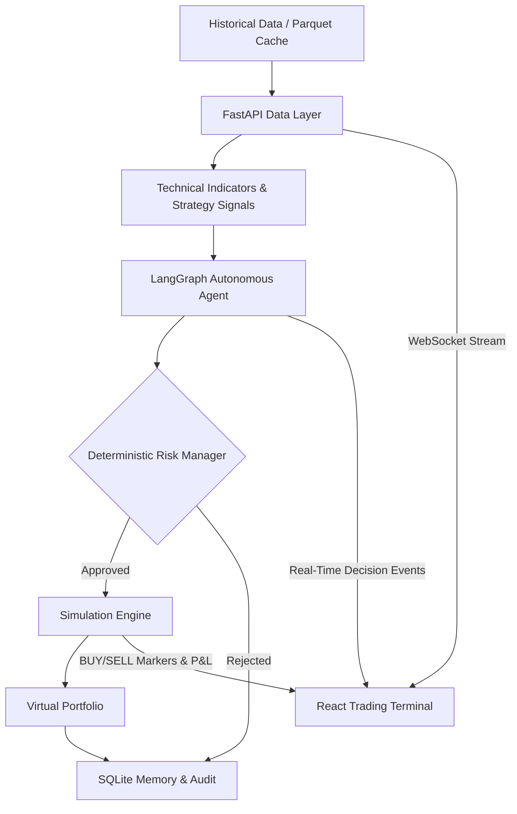

# Autonomous Trading Bot (Simulation-Based) — React + FastAPI + LangGraph + Dhan

> **CRITICAL SAFETY DIRECTIVE:**  
> **SIMULATION ONLY — NO REAL ORDERS WILL EVER BE PLACED.**  
> The system operates strictly inside an isolated virtual portfolio. There is NO path from AI decision to real broker execution.

---

## 1. Project Overview & Architecture
This project is an **Autonomous Agentic AI Stock Trading Terminal** that replays historical market data (default: **RELIANCE on NSE**) at accelerated speeds as if it were a live market feed, allowing an autonomous **LangGraph AI Agent** to make **BUY / SELL / HOLD** decisions through deterministic risk validation.

### Full-Stack Architecture:
- **Frontend:** React 19 + TypeScript + Vite + Tailwind CSS + TradingView Lightweight Charts
- **Backend:** Python + FastAPI + Uvicorn + WebSockets
- **Agentic AI Layer:** LangGraph State Machine (`OBSERVE` → `ANALYZE` → `REASON` → `RISK_CHECK` → `SIMULATE`)
- **Market Data:** Official DhanHQ API v2 (`/charts/intraday`, `/charts/historical`, `/marketfeed/quote`) + Local Parquet caching + Fallback synthetic market generator
- **Safety Gatekeeper:** Deterministic Risk Manager (Cash balance limits, 10% max order size, 25% max position concentration, 5% drawdown circuit breaker)
- **Virtual Simulation:** Long-only portfolio (initial ₹100,000 INR) with slippage (5 bps) and exchange fees



---

## 2. Quantitative Strategy & Agentic Workflow
The system uses an explainable **Dual Moving Average Crossover strategy with RSI Momentum Filtering**:
- **Indicators:**
  - **SMA-20:** Fast moving average for short-term trend.
  - **SMA-50:** Slow moving average for baseline market trend.
  - **RSI (14 periods):** Momentum oscillator (0–100 scale).
- **BUY Setup (80% confidence):** `SMA-20 > SMA-50` (Golden Cross) **AND** `Price > SMA-20` **AND** `45 <= RSI <= 70`.
- **SELL Setup (75% confidence):** `SMA-20 < SMA-50` (Death Cross) **OR** `Price < SMA-20` **OR** `RSI > 75` (Overbought exhaustion).
- **HOLD:** Market consolidation or lack of clear directional momentum.

---

## 3. Key Features
1. **TradingView Lightweight Charts:** High-performance dark-themed candlestick chart rendering rolling SMA-20 and SMA-50 overlays, and green/red BUY/SELL trade markers.
2. **Accelerated Live Replay:** Speed selectors from **0.5x up to 100x** (default 25x). Candles arrive progressively over WebSockets without dumping future data all at once.
3. **Zero Look-Ahead Bias Guarantee:** At historical simulation timestamp $T$, the agent and indicators have visibility strictly into data $\le T$.
4. **Deterministic Risk Protection:** AI only proposes trades; the `RiskManager` strictly enforces capital constraints before any simulated execution.
5. **Interactive Controls:** Instant `START`, `PAUSE`, `RESUME`, `STEP` (advance single candle), `STOP`, and `RESTART` session controls.

---

## 4. Quick Start & Execution

### Prerequisites
- Python 3.12+ (or 3.14)
- Node.js 18+

### 1. Start the FastAPI Backend
```powershell
# From project root:
.\.venv\Scripts\python.exe -m uvicorn app.api.server:app --port 8000 --reload
```
API runs on `http://localhost:8000` (Swagger docs: `http://localhost:8000/docs`).

### 2. Start the React Trading Terminal
```powershell
cd frontend
npm run dev -- --port 5173
```
Open your browser at 👉 **`http://localhost:5173`**.

---

## 5. Running Automated Tests
All 21 backend unit, replay, API, indicator, and schema tests run out-of-the-box:
```powershell
.\.venv\Scripts\python.exe -m pytest tests/ -v
```
To verify the frontend TypeScript production build:
```powershell
cd frontend
npm run build
```
